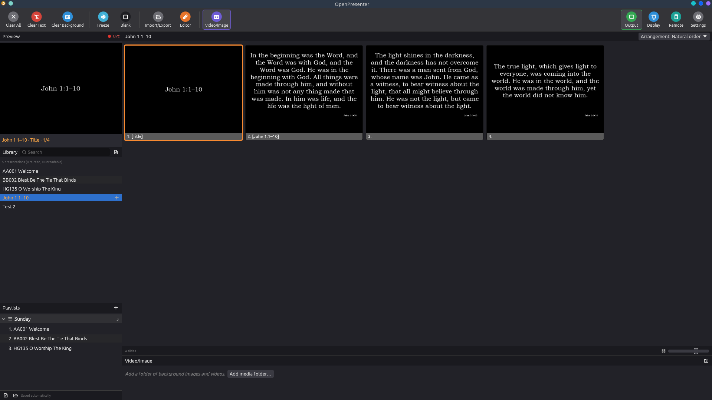
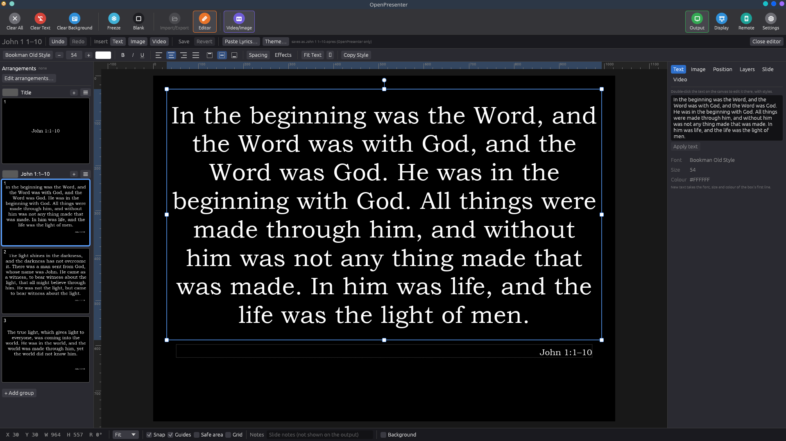
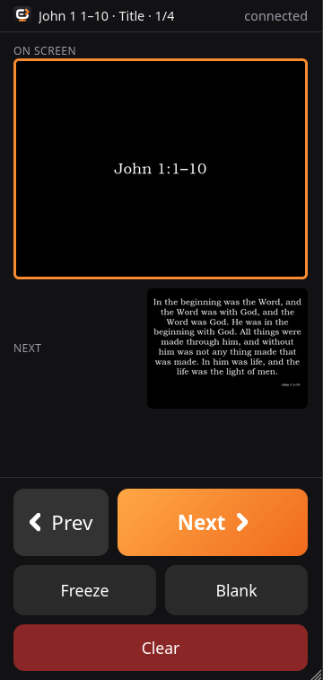

<p align="center"></p>

# OpenPresenter

Worship presentation software for Windows: an operator window, a full-screen output
window, a slide editor and a phone remote. It reads and writes ProPresenter 6 (`.pro6`)
presentations, and has its own format (`.opres`, themes `.optheme`) for things a `.pro6`
file can't hold.

- **Plan and status:** [`docs/PLAN.md`](docs/PLAN.md), editor: [`docs/EDITOR-PLAN.md`](docs/EDITOR-PLAN.md)
- **Building the installer and setting up the show PC:** [`docs/windows-setup.md`](docs/windows-setup.md); releases and code signing (CI): [`docs/release.md`](docs/release.md)
- **Branding (icon, colours, UI pattern):** [`docs/branding/ICON.md`](docs/branding/ICON.md)
- **Licence:** [`docs/LICENSING.md`](docs/LICENSING.md)

## Overview

OpenPresenter is built for the person running slides on a Sunday: fast to start, quick to
respond to a clicker, and designed so a problem never takes the screen down mid-service. It
opens an existing ProPresenter 6 library as it is, so a team can switch without converting
anything.



### Running the service

- **Operator window** laid out the way ProPresenter users expect: Preview, a searchable
  Library (titles and lyrics), Playlists, and the slide grid with each group's name and colour.
- **Playlists** as a collapsible tree. You can have several at once (e.g. morning and
  evening), and they save automatically. Next and Prev flow from one song into the next.
- **Arrangements** (Verse, Chorus, Verse, …) can be picked and switched live without leaving
  the current slide.
- **Clear All / Clear Text / Clear Background, Freeze and Blank**, each with its own key.
- **Clicker and keyboard** (Page Up/Down, arrows; configurable) work whichever window has
  focus.
- **Output** goes full screen on the projector at the slide's own resolution: fitted with
  black bars, or stretched to the screen as ProPresenter does (for a projector that squeezes
  a widescreen signal). It can be turned off and on without restarting.
- **Video and image backgrounds** (via libmpv) under the text. A slide can carry its own
  video with start, loop, end and picture settings.
- **Announcement loops**: timed presentations advance and loop on their own, with a countdown
  by the preview. The **Timers** panel shows every slide's time as a chain you can click to
  edit, sets every slide at once, and grid tiles carry a stopwatch badge. Timers save into
  `.pro6` files in ProPresenter's own format.

### Editing



- **Slide editor** with undo/redo: text boxes, fonts, sizes, colours, alignment, spacing,
  outline and shadow effects, Fit Text, images, video, position and layers. Snap, guides,
  safe area and a grid help with placement.
- **Groups and arrangements**: create, rename, recolour and reorder groups, move slides
  between them, and build arrangements by dragging group chips.
- **New songs from pasted lyrics.** Headings like `Verse 1:`, `CHORUS` or `[Bridge]` become
  groups.
- **Themes** to keep a look consistent, and **Copy Style** between slides.
- **Scripture import** from the ESV API: pick a passage and get slides sized for your theme,
  with the reference on each slide.
- **Quick edits from the grid**: right-click a slide to fix a typo, rename its group or
  disable it, without opening the editor.

### Phone remote



- **Control from any phone or laptop** on the church network, in the browser, with nothing
  to install. A PIN is shown in the app.
- **What's on screen and what's next**, as real slide images, with Prev / Next / Freeze /
  Blank / Clear.
- **On a wider screen** it also shows the playlists and the slide grid, so a second operator
  can run the service from a laptop.

<br clear="right">

### Files and safety

- **`.pro6` in, `.pro6` out.** ProPresenter 6 files open, edit and save as `.pro6`, and
  unchanged files are written back byte for byte. New presentations can use OpenPresenter's
  own `.opres` format for things `.pro6` can't hold.
- **Saves are safe**: every save is atomic and keeps the previous version as a backup.
- **Crash reports**: problems show as plain-English messages. A fault in a background task
  (remote, thumbnails, a bad file) is reported without closing the output.
- **`pp6tool`** checks a whole library: fonts used, files that don't parse, round-trip
  tests, bulk resolution changes and render-to-PNG.

<sub>Scripture quotations in the screenshots are from the ESV® Bible (The Holy Bible,
English Standard Version®), © 2001 by Crossway, a publishing ministry of Good News
Publishers. Used by permission. All rights reserved.</sub>

## Layout

| Crate | What |
|---|---|
| `crates/app` | the program (`openpresenter.exe`): operator UI, output window, editor |
| `crates/core` (`opcore`) | show state, commands, playlists, settings, library |
| `crates/doc` | native presentation model, `.opres`, `.pro6` conversion, edits, undo |
| `crates/pro6` | `.pro6` parser and writer |
| `crates/render` | slide rendering (no window/GPU dependencies) |
| `crates/media` | libmpv wrapper |
| `crates/web` | phone remote server |
| `crates/pp6tool` | `.pro6` conversion and diagnostics CLI (`pp6tool.exe`) |

```sh
cargo run -p app -- --help          # the program
cargo run -p pp6tool -- --help      # the .pro6 tool
packaging/build-installer.sh        # Windows installer (see docs/windows-setup.md)
```

## Licence

Copyright (C) 2026 John Peterson.

OpenPresenter is free software: you can redistribute it and/or modify it under the terms
of the GNU General Public License version 3, as published by the Free Software
Foundation. It is distributed in the hope that it will be useful, but WITHOUT ANY
WARRANTY; without even the implied warranty of MERCHANTABILITY or FITNESS FOR A
PARTICULAR PURPOSE. See [`LICENSE`](LICENSE) for the full text and
[`docs/LICENSING.md`](docs/LICENSING.md) for what that means in practice.

"ProPresenter" is a trademark of Renewed Vision. OpenPresenter is not affiliated with or
endorsed by Renewed Vision; it only reads and writes the `.pro6` file format.
